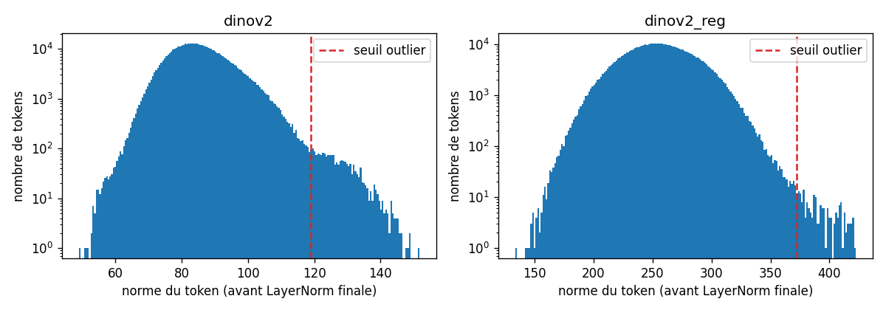
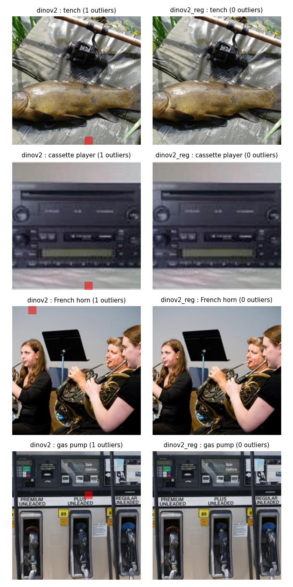
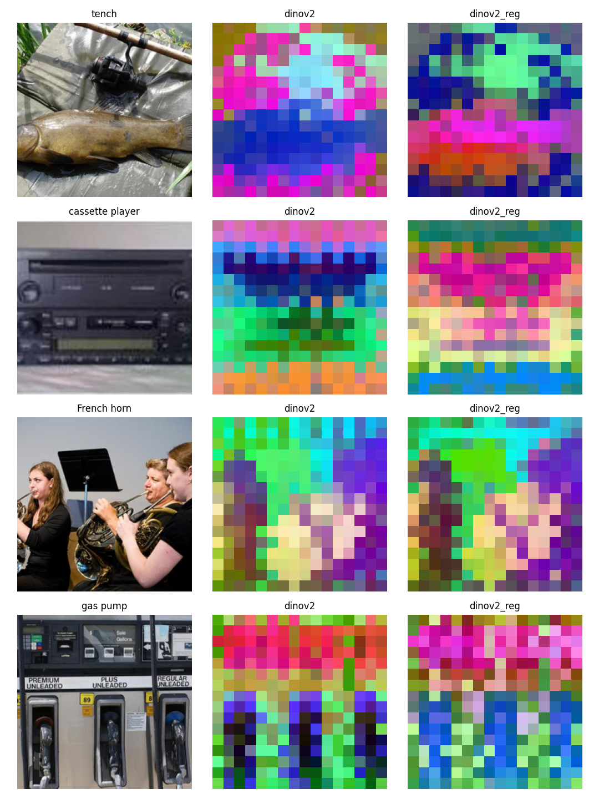

# distractor-probe

Dans *Diffusable Latents from Structure-Agnostic Distillation* (Ramanana Rahary, Dufour, Pérez, Picard,
Kyutai / ENPC, 2026), les auteurs montrent qu'aligner un descripteur **moyenné** (Pool-Align) fait aussi
bien que l'alignement **position par position** de VA-VAE (VF). Dans leur discussion (section 4), ils
font une hypothèse qu'ils ne testent pas : VF recopierait des « distracteurs » présents dans les tokens
de patch de DINOv2, à savoir **l'information de position** et les **tokens d'artefact à forte norme**
(Darcet et al., 2024), que le mean-pooling élimine.

Ce projet teste ces deux points **côté teacher uniquement**, sans entraîner d'autoencodeur ni de modèle
de diffusion, en comparant DINOv2 ViT-L/14 **sans** et **avec** registres sur 2000 images d'Imagenette.

## Structure

```
distractor-probe/
├── config.py                     # tous les paramètres
├── src/
│   ├── data.py                   # Imagenette : téléchargement, sélection, DataLoader
│   ├── models.py                 # chargement de DINOv2 et extraction des tokens
│   ├── analysis.py               # PCA, sonde de position, normes, pooling, k-NN
│   └── plots.py                  # figures
├── scripts/
│   ├── 01_extract_features.py    # extraction (une fois, mise en cache)
│   ├── 02_pca_visualization.py   # PCA des tokens en RGB (esprit de la Figure 3)
│   ├── 03_position_probe.py      # distracteur 1 : position
│   ├── 04_norm_outliers.py       # distracteur 2 : tokens à forte norme
│   ├── 05_knn_pooling.py         # le mean-pool garde-t-il la sémantique ?
│   └── 06_summary.py             # tableau récapitulatif, conclusions, limites
└── outputs/                      # figures/ et results/ (features/ non versionné)
```

## Lancer

Il faut un GPU (testé sur un T4 Colab) et environ 4 Go de disque pour les features.
Durée totale : environ 10 minutes.

```bash
pip install -r requirements.txt
python scripts/01_extract_features.py
python scripts/02_pca_visualization.py
python scripts/03_position_probe.py
python scripts/04_norm_outliers.py
python scripts/05_knn_pooling.py
python scripts/06_summary.py
```

Sur Colab (GPU T4) : `!git clone https://github.com/yassine11102003/distractor-probe.git`,
`%cd distractor-probe`, puis les mêmes commandes précédées de `!`.

## Résultats

2000 images d'Imagenette (val, 200 par classe), split train/test **par image** (1000/1000), graine 0.

| Mesure | DINOv2 | DINOv2-reg |
|---|---|---|
| Sonde linéaire : colonne d'un token (hasard 6,25 %) | 54,0 % | 41,0 % |
| … après retrait de la moyenne par position | 7,0 % | 6,8 % |
| Sonde linéaire : ligne d'un token | 50,6 % | 35,4 % |
| … après retrait de la moyenne par position | 8,0 % | 7,7 % |
| Part de la variance due à la position | 6,8 % | 5,6 % |
| Tokens à forte norme (médiane + 3 × IQR, avant LayerNorm) | 0,40 % | 0,04 % |
| Images avec au moins un tel token | 79,2 % | 1,5 % |
| cos(pool complet, pool sans ces tokens), images touchées | 0,99993 | 0,99882 |
| k-NN (k = 20, cosinus) : mean-pool | 98,2 % | 98,3 % |
| k-NN : mean-pool sans tokens à forte norme | 98,2 % | 98,3 % |
| k-NN : token CLS | 99,5 % | 99,3 % |

**Constats**

1. **La position est lisible linéairement** dans les tokens de patch (colonne retrouvée dans 54 % des cas,
   hasard 6,25 %), mais elle ne pèse que 6,8 % de la variance : elle n'apparaît pas dans les 3 premiers
   axes de la PCA, dominés par le contenu. Elle est **essentiellement additive** : retirer la moyenne de
   chaque position ramène la sonde à 7 %. Une telle composante devient une constante après mean-pooling.
2. **Surprise : les registres réduisent la position lisible** (41 % contre 54 % sur la colonne). Écart
   observé sur une seule graine, que ces mesures n'expliquent pas.
3. **Tokens à forte norme : la signature de Darcet et al. est là, mais faible.** Sans registres, environ un
   token par image, dans 79 % des images (sur les 4 images examinées, il tombe sur une zone de fond).
   Ils disparaissent presque avec registres.
   Mais ils ne représentent que 0,4 % des tokens (le seuil de 0,5 % fixé avant l'expérience n'est pas
   atteint), et l'histogramme montre un épaulement plutôt qu'un mode bien séparé.
4. **Le mean-pool y est insensible et garde la sémantique** : exclure ces tokens ne change ni le
   descripteur (cosinus minimal 0,994 pour DINOv2, 0,989 pour DINOv2-reg) ni le k-NN (18 erreurs sur 1000 dans les deux cas). Le token CLS fait un
   peu mieux que le mean-pool (5 erreurs contre 18).





Le détail complet, avec les règles de décision, est dans
[outputs/results/summary.md](outputs/results/summary.md).

## Limites et suite

- Analyse **côté teacher uniquement** : rien ici ne montre que ces distracteurs dégradent la diffusabilité.
  Il n'y a ni autoencodeur ni gFID.
- Imagenette (10 classes faciles) crée un effet plafond pour le k-NN.
- Une seule graine : l'écart entre modèles sur la position reste à confirmer.
- Prochaine expérience logique : entraîner VF avec DINOv2-reg contre DINOv2, et VF sur des tokens dont on a
  retiré la moyenne par position, puis comparer le gFID.
